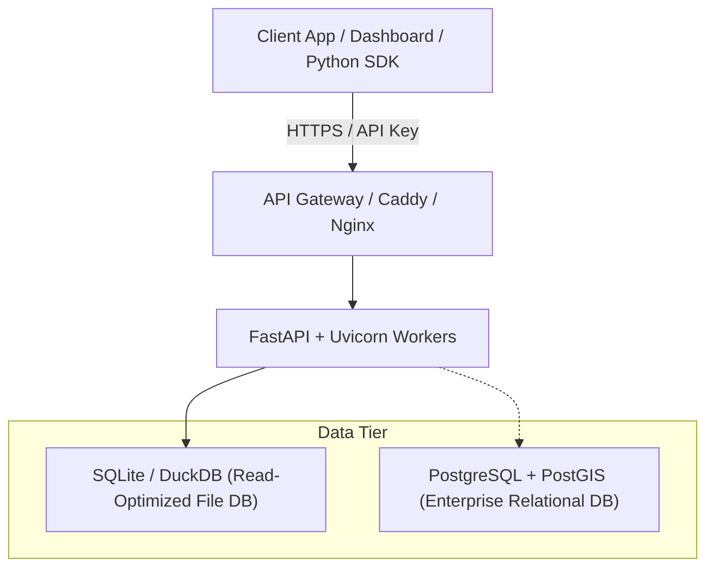

# Cloud Kitchen Geospatial Intelligence API

A high-performance RESTful API and GeoJSON service designed to expose multi-phase Google Maps, POI, housing proxy, competitor, and mobility datasets to client applications.

The API provides **dataset discovery**, **geospatial querying** (bounding box, radius search, full-text search), and **two-way client editing** (CRUD) on target pincode regions.

---

## 1. Quickstart

### Option A: Run Locally via Python / Uvicorn
```bash
# Install dependencies
pip install -r api/requirements.txt

# Start the API server
uvicorn api.main:app --host 0.0.0.0 --port 8000 --reload
```
Once started:
- **Interactive Swagger UI**: [http://localhost:8000/docs](http://localhost:8000/docs)
- **ReDoc Documentation**: [http://localhost:8000/redoc](http://localhost:8000/redoc)
- **Health Check**: [http://localhost:8000/api/v1/health](http://localhost:8000/api/v1/health)

### Option B: Run with Docker / Docker Compose
```bash
docker-compose -f api/docker-compose.yml up --build -d
```

---

## 2. Authentication & Role-Based Access Control (RBAC)

Pass the API key via the HTTP header `X-API-Key`:
```http
X-API-Key: demo-editor-key
```

| Role | Available Keys | Permissions |
|---|---|---|
| **Reader** | `demo-read-key` | Can discover pincodes, list datasets, query rows, and stream GeoJSON. |
| **Editor** | `demo-editor-key` | All Reader permissions + **Create (POST)**, **Update (PATCH)**, and **Delete (DELETE)** entities. |
| **Admin** | `admin-master-key` | Full administrative control. |
| *Dev Mode* | *(Omit header)* | Defaults to Editor permissions for local development and testing. |

---

## 3. API Endpoints Reference

### 3.1 Pincode & Dataset Discovery

#### `GET /api/v1/pincodes`
Returns all geographical regions supported by the engine with demographic summaries, bounding boxes, and cloud kitchen feasibility ratings.

#### `GET /api/v1/pincodes/{pincode}/datasets`
**Discovery Endpoint**: Tells the client exactly what datasets are available for that pincode, their schema, primary key, row counts, and supported query filters.

**Example Response**:
```json
[
  {
    "dataset_name": "fact_competitors",
    "title": "F&B Competitor Landscape",
    "description": "Commercial restaurants, cafes, cloud kitchens, and QSR chains...",
    "primary_key": "competitor_id",
    "row_count": 473,
    "column_count": 34,
    "spatial_columns": {"lat": "latitude", "lon": "longitude"},
    "supported_operations": ["GET (List)", "GET (Detail by ID)", "POST (Create)", "PATCH (Update)", "DELETE (Delete)"],
    "endpoints": {
      "list_and_filter": "/api/v1/pincodes/560034/datasets/fact_competitors",
      "detail_or_edit": "/api/v1/pincodes/560034/datasets/fact_competitors/{id}"
    }
  }
]
```

---

### 3.2 Querying Datasets

#### `GET /api/v1/pincodes/{pincode}/datasets/{dataset_name}`
Retrieve paginated rows with flexible filtering:

| Query Parameter | Type | Description | Example |
|---|---|---|---|
| `q` | `string` | Full-text search (matches name, brand, locality) | `?q=EatFit` |
| `category` | `string` | Filter by category | `?category=Cloud+Kitchen` |
| `min_rating` | `float` | Minimum Google rating | `?min_rating=4.2` |
| `is_cloud_kitchen`| `bool` | Filter cloud/dark kitchens only | `?is_cloud_kitchen=true` |
| `near_lat`, `near_lon`, `radius_km` | `float` | Spatial radius search | `?near_lat=12.9362&near_lon=77.6205&radius_km=1.5` |
| `min_lat`, `min_lon`, `max_lat`, `max_lon` | `float` | Bounding box spatial filter | `?min_lat=12.92&min_lon=77.61&max_lat=12.94&max_lon=77.63` |
| `limit`, `offset` | `int` | Pagination controls | `?limit=50&offset=0` |

---

### 3.3 Client Editing (CRUD) on Pincode Regions

#### 1. Add / Create an Entity (`POST`)
Clients can add new locations (e.g., newly surveyed competitor, proposed kitchen site):
```bash
curl -X POST "http://localhost:8000/api/v1/pincodes/560034/datasets/fact_competitors" \
  -H "Content-Type: application/json" \
  -H "X-API-Key: demo-editor-key" \
  -d '{
    "outlet_name": "Proposed Dark Kitchen Pod - Sony World Corner",
    "brand_name": "New Venture Kitchen",
    "primary_category": "Cloud Kitchen",
    "cuisine_type": "Biryani, Rolls, North Indian",
    "sub_locality": "Koramangala 4th Block",
    "latitude": 12.9365,
    "longitude": 77.6255,
    "rating": 4.5,
    "total_reviews": 120,
    "price_level": "$$",
    "avg_order_value_inr": 380,
    "is_cloud_kitchen": 1,
    "estimated_monthly_orders": 3500,
    "dine_in_takeaway_delivery_flags": "Delivery"
  }'
```

#### 2. Edit / Update an Entity (`PATCH`)
Clients can modify existing entities (e.g. adjust order estimates, change rating, update commercial rent):
```bash
curl -X PATCH "http://localhost:8000/api/v1/pincodes/560034/datasets/fact_competitors/FNB_560034_001" \
  -H "Content-Type: application/json" \
  -H "X-API-Key: demo-editor-key" \
  -d '{
    "rating": 4.6,
    "total_reviews": 520,
    "estimated_monthly_orders": 5000
  }'
```

#### 3. Delete an Entity (`DELETE`)
Remove an outdated or closed location:
```bash
curl -X DELETE "http://localhost:8000/api/v1/pincodes/560034/datasets/fact_competitors/FNB_CUSTOM_560034_0001" \
  -H "X-API-Key: demo-editor-key"
```

---

### 3.4 GeoJSON Streaming for GIS & Map Clients

#### `GET /api/v1/pincodes/{pincode}/geojson`
Streams standard `FeatureCollection` GeoJSON compatible with:
- **Mapbox GL JS** (`map.addSource('data', { type: 'geojson', data: url })`)
- **Leaflet** (`L.geoJSON(data).addTo(map)`)
- **Google Maps JS API** (`map.data.loadGeoJson(url)`)
- **Kepler.gl / Deck.gl / QGIS**

---

## 4. Production Deployment Architectures



### Recommended Hosting Options:
1. **Google Cloud Run (Serverless Container)**: Deploy the containerized API with automatic scaling to 0 when idle.
2. **AWS App Runner / ECS Fargate**: Fully managed container execution with SSL termination.
3. **Supabase (Managed Backend Alternative)**: Import the generated `postgresql_schema_and_load.sql` directly into Supabase to get auto-generated PostgREST APIs, Row Level Security, and Realtime Webhooks.
